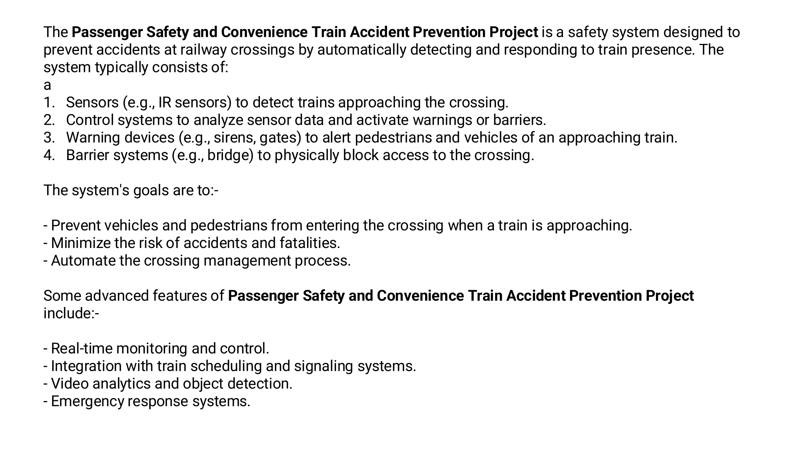

# Automated Railway Crossing Safety System

> **A prototype railway-crossing safety system designed to detect an
> approaching train and automatically control warning and barrier
> mechanisms.**

## 🚦 What I Built

This project focuses on **automating railway crossing safety** by
combining an **IR sensor, relay-based control, buzzer, and motor-driven
barrier**.

When a train is detected near the crossing, the system can trigger a
warning and operate the barrier to help prevent vehicles or pedestrians
from entering the crossing.



## ⚙️ How It Works

``` text
Train Approaches
       ↓
   IR Sensor
       ↓
 Control / Relay
    ↙       ↘
 Buzzer    Gear Motor
  Alert     Barrier
       ↓
 Crossing Protected
```

### Key Flow

1.  **IR sensor** detects the approaching train.
2.  The **control/relay circuit** responds to the sensor signal.
3.  The **buzzer** provides an audible warning.
4.  The **dual-shaft gear motor** operates the barrier mechanism.
5.  The crossing is restricted while the train is approaching.

## 🔧 Components Used

  Component               Purpose
  ----------------------- -------------------------------
  IR Sensor               Detects train/object presence
  Single-Channel Relay    Controls an electrical load
  Dual-Channel Relay      Controls two separate loads
  Dual-Shaft Gear Motor   Drives the barrier mechanism
  Buzzer                  Provides warning alert
  Battery                 Power source
  Jumper Wires            Circuit connections

## 🔌 Circuit


The prototype uses relays to isolate/control the higher-power loads,
while the sensor provides the detection input.

## 🎯 Project Goals

-   Prevent vehicles and pedestrians from entering when a train is
    approaching
-   Automate railway-crossing management
-   Provide an early warning through an audible buzzer
-   Operate the physical barrier automatically
-   Improve safety and reduce the possibility of crossing accidents

## 🧠 Key Concepts

-   Infrared sensing
-   Relay-based switching
-   Motor control
-   Automated safety systems
-   Embedded/electronic prototyping

## 📌 Outcome

The project demonstrates a **low-cost automated railway-crossing safety
concept** where sensing, warning, and barrier control work together to
improve crossing safety.


## 👥 Project

**Passenger Safety and Convenience Train Accident Prevention Project**

Built as an electronics/automation prototype with a focus on **railway
crossing accident prevention**.

------------------------------------------------------------------------

### Tech / Hardware

`IR Sensor` `Relay` `Gear Motor` `Buzzer` `Battery` `Jumper Wires`
